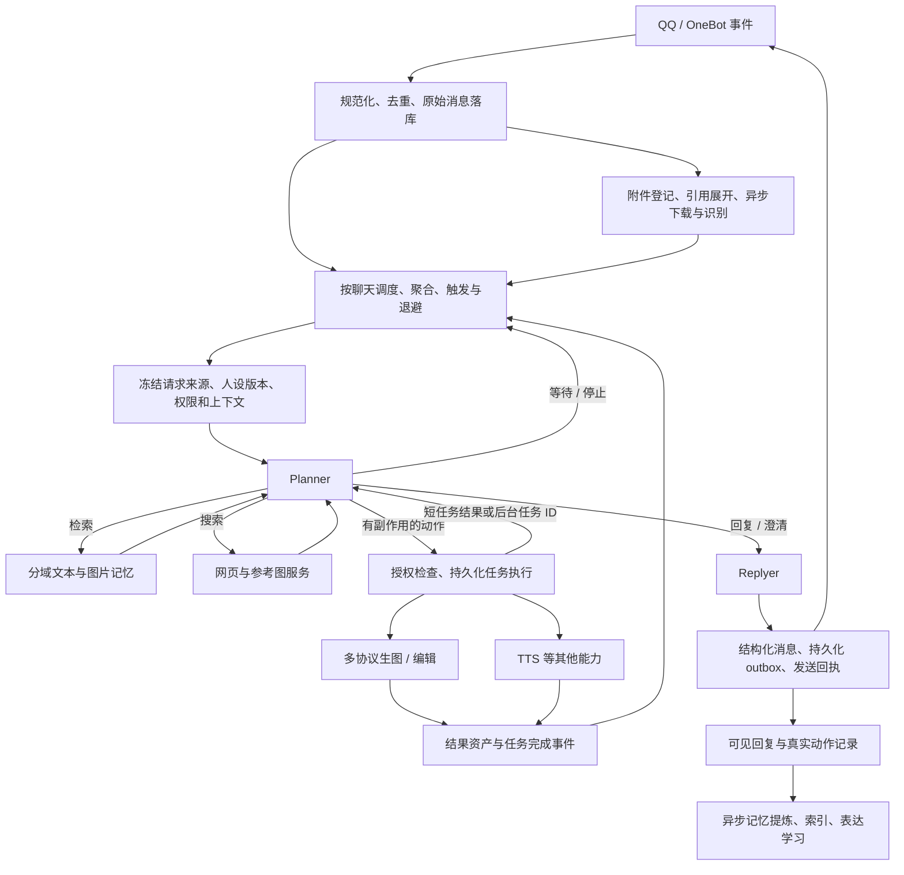

# Aurabot 完整重构方案

版本：讨论稿 v2，2026-10-28。依据：[源码比较、22 个模拟场景与证据边界](AUDIT-COMPARISON.md)；本次吸收用户提供报告后的核验与取舍见 [外部审计复核](EXTERNAL-AUDIT-REVIEW.md)。本文描述目标实现，不表示这些能力已经落地。

v2 主要补充：事实去重契约、人物画像证据缓存、增量提炼触发、群内黑话词典、表达学习队列、拆句保真、表情审核状态、Hook 规格与摘要契约；同时收紧缺失消息 ID 时的去重规则。

## 1. 推荐决策与交付范围

采用以群聊体验为中心的完整架构：**会话调度 + Planner / Replyer 分工 + 统一媒体资产 + 可恢复任务 + 分域记忆 + 版本化人设**。完整实现后发布一个版本；内部按依赖分批开发、联调，避免最后才发现接口互不兼容。

| 范围 | 本轮决定 |
| --- | --- |
| 聊天 | 保留 DSH + QQ 桥接，重构接收、聚合、参与判断、工具执行、回复发送 |
| Planner | 引入；负责行动选择、依赖和是否回复。Replyer 负责最终措辞；代码负责权限、状态、额度和回执 |
| 人设 | 多卡片、草稿/发布/回滚、分群/私聊绑定、身份/行为/语言风格分层、外观参考、音色、学习与情绪策略 |
| 生图 | 多服务、多模型；文生图、参考图生成、原图编辑、蒙版编辑、多图输入、生成版本与追问修改；能力按模型和协议限制 |
| 搜索 | 插件内 Tavily 适配、网页提取、参考图候选与来源验证；搜索服务接口可扩展 |
| 记忆 | 文本混合检索、图片检索、语义去重、分层人物画像、群内黑话词典、证据/时间/冲突管理、范围隔离、重建索引、删除传播、可解释的记忆面板 |
| 表情包 | 自动收藏、去重与额度、描述/OCR、语义候选、视觉选择、允许放弃选择、独立 QQ 收藏同步 |
| 语音 | TTS 收敛为外部 API；ASR 作为入站能力独立保留；统一音频格式转换与回执 |
| 功能删除 | QQ空间与抖音：运行模块、路由、任务、配置、界面、依赖、说明同步移除 |
| 其他功能 | B站、翻唱等未被要求删除的功能先保留独立模块，接入新任务/权限接口，不能默认扩大裁剪范围 |
| 运维 | 配置迁移、任务恢复、诊断、成本统计、回放评估、独立发行配置一起完成 |

“完整”指能力、数据契约和异常路径一并完成。无须为了完整而强制部署多个数据库，也不能用只声明接口、以后再实现的方式省掉本次已确定的能力。

## 2. 用户体验验收样例

以下对话应在不使用特殊命令的情况下工作，必要歧义只追问一次关键问题：

- 同一个人连续发“帮我画一下”→图片→“换成雨天”，归为同一请求；图片下载慢不会先生成一张无参考图的结果。
- 回复三天前的一张图说“改成夜景”，使用引用消息里的指定图片。引用里有多张且不能确定时，询问哪张。
- 群友 A 请画角色，群友 B 随后发自拍，B 的自拍不会成为 A 的参考图。
- 说“画某作品里的某角色穿雨衣”：先用可靠缓存或搜索确认角色，挑可验证的参考图，再交给支持参考图的模型；识别不清或参考下载失败时说明缺少什么。
- 出图后说“保留脸，把背景改成海边”，继承明确的任务和图片版本，保留身份参考；不会选同群最近随便一张图。
- 生图期间继续聊天，任务在后台进行；说“取消我刚才那个”只取消自己的明确任务。发送失败保留结果以便重发，不重新付费生图。
- “上次约好几点碰面？”能检索到原话和日期；出现“改到四点”时展示更新后的约定，并保留旧记录的失效关系。
- “找一下上周那张红裙子图”能通过文本描述、聊天说明和图片索引定位；一张图仅在私聊出现时，不会被群聊查询泄漏。
- 两个群使用不同人设；同一人设改文风从下一轮生效；切换身份不会夹带旧角色的自我习惯、私聊情绪原因和未完成旧回复。

## 3. 总体链路与职责

### 主循环

- `ConversationScheduler` 按 `(botAccountId, chatId)` 管理接收序列、媒体就绪、活动回合和待办事件；同一会话只有一个当前决策回合。
- 复用 DSH 的 agent 工具循环。Planner 是明确的会话角色，不另套一个无限“思考→执行→思考”循环与宿主争抢状态。
- `Replyer` 接收已确认的任务状态、可见证据和回复意图，不自行执行群管、生图或网络工具。普通闲聊也经过统一的回复通道，取消与错误提示可用确定性短句。
- 搜索、记忆、视觉等无副作用读取可以并行；有费用或外部状态变化的操作经执行器登记后进行。长期任务立即返回 `jobId`，不能占住聊天回合等几分钟。
- 每个事件及动作都有 `traceId`，可以从用户消息追到参考图、模型调用、生成结果和 QQ 回执。

### DSH 适配的实施前置检查

已有代码能创建 agent、followup、部分情况下 steer，并使用宿主 LLM。尚未核实所有宿主版本是否提供按调用绑定系统提示词、取消执行和工具返回事件的完整契约。

先建立小型宿主契约测试，验证角色化提示词、会话映射、工具上下文、停止/重启和模型能力查询。若全局提示词变量拿不到聊天上下文，改用会话专属配置或经适配层显式构造模型请求，不能继续依赖全局 `persona.current`。即使宿主无法物理中断请求，`epoch` 校验也必须阻止迟到结果发到 QQ。

## 4. 接收、引用、防抖与群聊参与

1. **接收即登记**：保存平台 message ID、聊天、作者、平台时间、本机接收时间与单调接收序号、消息段、引用与转发关系。去重键包含账号、聊天、事件类别和平台 ID，或适配器提供的可靠事件序号。缺少可靠来源 ID 时给事件分配内部 ID，内容指纹仅用于诊断/关联，不能把连续两条“哈哈”或两张同图默认为重传而丢弃。此时无法保证跨重连去重，应标记能力缺口，收费动作仍走请求账本，不能声称已解决来源不可辨识的重复事件。
2. **先保留身份再下载**：图片/语音段先得到 occurrence ID，随后下载、ASR、OCR、视觉描述回填到原消息。不能用“某用户最后一条消息”回填。
3. **有界聚合**：使用本机接收时刻与单调时钟计时，平台时间保留为内容证据；区分同人连发、换人、明确 @、图片待补、正在回答的请求。建议联调起点为普通静默 2 秒、聚合上限 5 秒，待图片可延长到 8 秒；明确 @ 缩短等待。纯表情不持续延长已开批次；已到期、仅因模型忙而尚未消费的批次不能被新消息重新延长。这里只是初始配置，不承诺模型回答也能在该时间内完成。
4. **媒体超时显式化**：窗口耗尽仍未就绪，保留 `pending` 并等待/澄清，不把“编辑这张图”降为无图文生图。普通不依赖图片的闲聊可继续。
5. **参与判断分层**：黑白名单、静默/暂停、显式请求与 @、跟进关系、最近发言频率、空闲退避、主题相关性。显式有效请求与自动插话分别计限流；心情不能让已承诺任务失联。
6. **补充与取消**：新信息关联明确 request ID；尚未提交的草稿可更新，已经提交的生图不能悄悄改参数，转为后续编辑或提示当前状态。取消只影响关联任务，不能按整群粗暴清空。
7. **引用与转发**：引用消息恢复可用的正文与附件；嵌套转发限制层数与数量，保存每层作者与来源。转发文字里自称主人、引用主人话语，都不能改变当前请求者身份。

上下文按“当前明确请求→其引用和附件→相关近期消息→可见记忆→其他群聊背景”分配预算。裁剪依赖稳定 ID，不能因第一张下载失败就把第二张重编号为第一张。确定留下的图片再编码，避免提前把大量 base64 填进缓存和日志。

**退避与配额的更新粒度**：以实际决策批次/回合为单位记录“主动选择不参与”，不是每次收到无关消息都增加退避次数。连续无动作可指数增加自动插话检查间隔；明确 @、当前请求补充和任务完成事件按各自策略唤醒。空闲退避、群聊发言额度和收费任务额度是不同控制器，不能用一条曲线取代所有限制。

动态频率控制保留预计参与量、实际成功回复量、虚拟批次与反馈；突发消息到来时反馈先收紧，避免积压令机器人突然刷屏。是否值得接话与当前还能说多少次分开估计。MaiBot 的拟合系数不直接搬用，尤其其“近期自己发言占比”系数实际为正，不能误读成发言过多惩罚。

## 5. Planner、执行器与权限

### Planner 的职责和预算

Planner 选择 `reply`、`ask_clarification`、`wait`、`stop`、`search`、`recall`、`submit_job` 等有限动作，说明目标 request ID、输入资产和依赖。保留结构化动作摘要与实际结果，无须持久化模型的自由推理过程。

建议初始上限：一次唤醒最多 4 轮决策、6 次工具调用，网页参考图最多 2 轮搜索。预算耗尽后给出可用结果或明确等待状态，不能重复自我唤醒。参数可调，须用回放统计成本与延迟。

复杂图像请求生成可持久化依赖链，例如 `定位原图→确认人物→收集参考→生成→发送`；代码保存步骤、输入和前置结果，模型不能修改历史步骤的成功状态。

`wait` 必须登记唤醒条件/期限和等待的 request/job ID；`stop` 表示当前决策结束，不等同于取消任务；“不发可见回复”只是输出选择，不能替代前两者。宿主不直接支持这类原语时，由插件工具与调度器配合实现，仍须验证 DSH 契约。

搜索长正文、参考图清单与后台分析使用类型化结果存储；进入模型的仅是有来源 ID 的有界摘要，必要时按 ID 读取原文。异步完成作为新事件追加，不改写已经提交的历史，也不把超时视为后台工作必定失败。无须复制 MaiBot 的整个子代理运行时。

### 请求级授权

`RequestContext` 由接收层建立：`requestId / actorId / sourceMessageIds / chatId / replyTarget / policyRevision / conversationEpoch`。工具不能让模型任填操作者或目标群来绕过它。

- 不同人的请求分别携带授权，即使共处一轮聊天也不能合并权限。
- 主人说“你好”不能授权旁边群友要求禁言、删图或操作电脑。高权限自然语言操作仅接受经绑定的主人请求上下文；引用、网页、群友补充都只是数据。
- 模型引用了有效 request ID，也仍须由执行器检查目标、动作类别、归属、范围和额度。必要时回到主人当前请求澄清，不能通过“本轮有主人”放行。
- 群聊只获得当前群允许的 QQ / 搜索 / 媒体能力；主人私聊的桌面工具保留独立能力配置，不能经群聊人设或记忆取得。
- 图片、表情管理、配置修改和任务取消各有权限。普通成员可使用获准功能，不自动获得全局库的改名删除权。
- 每用户/群/服务的并发与费用额度用事务或原子预留；任务失败按确定状态释放预留，不能由模型自行报账。

所有回调、重试和定时唤醒沿用同一请求归属；角色卡和插件声明只能提供说明，不能授予 QQ 用户权限。

## 6. 人设管理与一致性

### 数据结构与管理

`Persona` 采用稳定、严格校验的 ID；非法 ID 拒绝，不通过删字符生成别名。`PersonaRevision` 是不可变发布版本，保存：

| 层 | 内容 | 使用方 |
| --- | --- | --- |
| 身份与核心性格 | 名字、称呼、关系设定、稳定性格 | Planner 与 Replyer |
| 行为风格 | 参与群聊的偏好、主动程度、何时追问 | Planner；仍受运行策略限制 |
| 回复风格 | 用词、句式、长度偏好、示例、禁用表达 | Replyer |
| 外观与角色资料 | 外观描述、固定角色参考图、明确标注的虚构背景 | 自画像/角色相关生成和角色叙述 |
| 语音 | voice profile、语速等受服务支持的参数 | TTS |
| 情绪与学习策略 | 可用情绪范围、学习/使用开关、共享策略 | 情绪与表达学习服务 |

界面支持创建、复制、草稿、发布、历史比较、回滚、归档、导入/导出。保存携带编辑 revision，拒绝过期覆盖；切卡提示未保存状态并丢弃迟到的加载结果。归档正在使用的卡需先完成绑定迁移，不能留下悬空引用。

内置卡只在首次初始化/明确导入时登记；用初始化记录与 tombstone 区分“从未导入”和“用户已删除”，不能每次读取自动复活。

### 绑定与版本切换

绑定优先级：具体聊天 → 群聊/私聊类型默认 → 全局默认。可选情境覆盖只能修改允许的风格项，并记录有效期，不能覆盖身份或权限。

- 开始一轮时冻结 `personaId + personaRevision + bindingRevision + promptVersion + modelProfileVersion`。工具和后台学习任务显式接收该快照。
- **同一身份修订**：新回合使用新版本，进行中的普通回复使用原快照完成；不抹掉事实记忆。
- **切换身份**：新会话 epoch、新 DSH 会话或等效隔离；旧普通回复不能迟到发送。旧历史保留但按角色标注，不当作新角色的自传。
- **切换时有生图任务**：任务继续按创建时的人设外观和参数生成，资产保留归属；完成通知由当前会话以中性状态消息或当前 Replyer 发出，不能复活旧角色的未完成台词。取消任务与切换人设是两个操作。
- 人设引用失效时进入明确的配置错误状态，并使用预设的中性错误提示；不随机换为第一张卡。

事实记忆可在同一聊天可见范围内继续用于回答，但“哪个角色经历了什么”仍保留主体。角色自我经历、表达学习和情绪默认按 `(chatId, personaId)` 隔离；跨群/跨角色共享必须是显式配置。

### 提示词编译

统一 `PromptCompiler` 按角色编译：运行边界与真实能力 → 人设适用层 → 当前可信请求元数据 → 来源标注的上下文/记忆 → 本阶段输出契约。模型可读内容中的指令不改变执行器权限。

后台事实提炼、OCR、索引等使用客观任务提示词，按需读取身份元数据，不让它们扮演“大肥鱼”或整套新角色。通用输出格式、工具规则、失败表达从角色正文移出。角色外观只在画该角色时注入，不能让所有人物都长成机器人自身。

面板预览实际生效的各层、来源、版本、模型能力与预算。QQ 账号真实头像是账号级资源；每群人格的参考头像/面板头像不承诺改变同一个 QQ 账号在不同群的头像。

### 摘要与模板的确定性约束

对话摘要使用 `topics / background / progress / pending / agreements` 等结构化字段，注明说话人、证据 ID 与适用时间。固定人设、系统规则、检索注入的长期记忆不循环抄入摘要；未回应的分享不自动变成待办；“同意执行”和“调用工具”不等于完成。摘要后用任务账本核对 pending/progress，真实失败、未知状态和取消不得被压成“已完成”。

保留 DSH 的上下文压缩职责；宿主允许配置时接入此摘要契约，否则使用插件的范围化对话摘要并限制重复注入。模型输入中的网页、OCR、聊天记录均作为待分析材料，不能成为新的系统规则。

模板在测试中严格校验占位符。生产缺少必需的人设/权限/来源字段时阻止该次模型请求并报告配置错误，非关键文风字段可使用声明的默认值；不能回退成别的聊天/角色的值。上下文通过显式参数或异步局部上下文传递，不使用进程全局临时变量切换。

## 7. 模型角色与降级

统一管理 Planner、Replyer、视觉理解、记忆提炼、表达筛选、文本 embedding、图片 embedding、联合空间查询编码器、reranker、搜索综合、生图和 TTS 的配置角色。可以复用同一服务，但调用契约、超时、预算和能力分开。

- 最终选中的模型配置决定是否接收图片；不能再按全局默认模型裁图。
- 角色配置按全局→聊天继承，面板显示最终生效值和来自哪层。
- 降级模型必须满足当前阶段需要的能力。需要编辑图片时不能静默切到仅文生图；文本模型可以利用已提取描述，但不能声称看到了未处理的原图。
- 搜索、embedding 或 rerank 暂不可用时保留明确状态和可用路径：词法检索、已知引用、已有资产；若无法满足核心要求就暂停该任务。
- 不把所有阶段都强制设成最贵模型，也不靠单一便宜模型承担全部任务。最终预算与模型选择用实际质量测试决定。

## 8. 媒体资产与参考图解析

### 资产和出现记录分离

- `Asset`：内容哈希、MIME、尺寸、字节位置、来源类型、派生版本、存储状态。
- `AssetOccurrence`：在哪条消息、哪个聊天、由谁发送、片段序号、引用关系、可见范围、时间。
- `ImageAnalysis`：描述、OCR、分析模型/版本、置信或失败状态，与具体可见上下文分别存储。
- `GenerationLineage`：生成任务、输入资产及角色、输出 asset ID、父版本、编辑意图、实际提供方参数。

同图可去重存储，出现记录不能去重丢失。纯视觉描述与含私聊信息的描述分开；后者继承私聊范围。原图、模型预览、缩略图和编辑蒙版分别保存尺寸与坐标变换，不能用缩略图坐标直接裁原图。

### 参考选择优先级

明确 asset/message 引用 → 当前请求附件 → 当前请求者明确关联的生成任务 → 当前会话可见的历史候选 → 外部检索。只把“最近一张图”作为有唯一明确关联时的候选，不能作为隐式通用答案。

`ResolvedReference` 至少含 `assetId / occurrenceId / role / sourceMessageId / selectionReason`，role 包括 base、identity、style、composition、mask。身份图、背景图、编辑基底不能只塞进一个无序数组让提供方猜。

入站 URL 与管理员配置的服务地址分开信任：用户给的图片不允许读取本地路径，网络抓取限制大小、解码资源、超时并检查每次重定向；管理员明确配置的本地 ComfyUI 可访问约定的局域网端点。模型输出只能发送登记资产 ID，不能让 Markdown 路径直接进入文件读取。

## 9. 生图协议、任务与编辑

### 统一请求

`ImageRequest` 包含 `requestId, mode, prompt, references[], mask, outputSpec, providerProfile, parentJobId, personaSnapshot, budget`。mode 为文生图、参考图生成、原图编辑、蒙版编辑；具体服务能实现哪些模式由能力表决定。

区分“参考人物长相重新画一张”和“保留这张图大部分像素只改一处”。前者不承诺精确像素保持；后者只有模型/工作流真正支持时才提供。蒙版的透明度/黑白含义在适配层规范化并预览。

| 适配器 | 本轮实现内容 | 不能默认假设的能力 |
| --- | --- | --- |
| OpenAI Images 及兼容服务 | generation、multipart edit、多图/蒙版（按模型）、URL/base64 输出、尺寸/质量/格式映射 | 不是每个中转都支持相同字段；`response_format` 等参数也不能无条件发送 |
| Gemini 原生多模态 | 原生内容块、多图输入、图文结果、模型支持的编辑及对话状态 | 不能把所有 Gemini 模型当成图像输出模型；有要求的原生状态/签名按协议保留 |
| ComfyUI | 上传资产、绑定已登记工作流输入、提交、WebSocket/轮询状态、历史输出、可用取消 | 工作流节点决定文生图/图生图/编辑能力；用户聊天不能任意提交宿主文件路径或任意工作流 |
| 配置化 HTTP 中转 | 管理员定义的请求/响应映射；同步与 submit/status/result/cancel 异步模板 | 不执行任意 JS 模板；不能宣称任意厂商无需适配就全部可用 |

能力描述保存到模型/工作流配置：输入图数量、输入角色、支持的编辑模式、输出格式、大小、异步查询、取消和幂等能力。管理员声明 + 接口校验 + 实际联调共同确认；发现服务不支持某字段，应明确拒绝或协商修改要求，不能静默丢图、丢蒙版。

### 任务状态

`queued → preparing → submitting → running → generated → delivery_pending → delivered`，并支持 `waiting_input / retry_wait / failed / cancel_requested / canceled / unknown`。每次外部尝试保存 attempt ID、provider task ID、计费状态是否可知、输出和错误分类。

- 本地先事务登记任务和额度，再发请求。任务 worker 用租约和心跳防重复领取，启动时恢复可对账任务。
- 生成结果先保存为资产，再发 QQ。发送失败只重试发送；不能重新生成来代替重发。
- 请求可能已被服务接收但连接断开时标 `unknown`，优先按 provider ID/幂等键查询；服务不支持对账时，不自动重发可能重复计费的请求。
- 可确定未执行的临时故障才能按策略重试；有上限和退避。跨服务回退也须保留需求能力、额度和完整尝试记录。
- 取消是可查询的过程：服务支持则请求取消；不支持或已完成则阻止后续自动发送并说明状态，不假报“已经停止计费”。
- 每群、每用户、每提供方有公平队列与并发上限。进度消息限频，主动查询可查看状态；重启后不刷一屏重复进度。
- 可选输出视觉检查只检查明显缺项/损坏/参考偏离，不能承诺精确身份或画质。最多一次受预算约束的重做，关闭时照常返回原结果。

## 10. 网络搜索与自动找参考图

### 服务边界

插件内实现 `searchWeb / extractPage / searchImageCandidates`。Tavily 是首个正式适配器；网页命中、页面正文和图片候选使用不同类型，分别保存来源、时间、查询与缓存策略。仅有搜索摘要不等于读过完整页面。

Tavily 请求图片结果时使用服务支持的 `include_images` 等参数，并校验实际响应；图片 URL、来源页和描述不完整时补查。没有来源关系的 URL 不能被包装成“已验证角色参考图”。普通聊天搜索要能给出对应链接，群聊不必把全部检索过程刷屏。

### 何时搜索

| 请求 | 默认行为 |
| --- | --- |
| 用户明确指定了图片或编辑基底 | 优先使用该图；只有缺少用户要求的外部信息时才搜索 |
| 普通场景“画一只戴帽子的猫” | 直接生成，避免无意义搜索 |
| 指定知名角色/人物且希望外观准确 | 先查经过验证、可用的角色参考缓存；没有则搜索并核对 |
| 重名、同名不同作品、不同造型版本 | 根据上下文消歧，仍不明确就问一次 |
| 用户自己的 OC、未公开人物或仅有昵称 | 请求已有参考或外观说明；不能把搜索到的同名对象冒充目标 |
| “画你自己” | 使用当前人设外观及授权参考图，不自动搜索同名真人 |
| 用户指定不要搜索 | 遵循请求，说明会基于现有材料生成 |

### 参考验证流水线

实体名称/作品/版本确认 → 来源页核对 → 图片下载与格式检查 → 图文对应性、清晰度、遮挡/拼图/水印检查 → 生成引用资产与来源说明 → 生图。

建议初始预算：最多 2 轮搜索，每轮最多下载 6 个候选，通常保留 1–3 张适用参考，受目标模型输入数约束。视觉模型用于检查候选是否符合描述，不用人脸相似度独立认定现实人物身份。

稳定性策略：优先可信且可追溯的来源，成功验证的结果可缓存；反盗链/过期链接只作有限重试；多个证据矛盾就澄清。如果准确外观是用户核心要求而没有合格参考，暂停并说明缺口；普通创作可在明确告知只基于文字描述的前提下继续。不要生成后才声称“我已经搜过参考”。

参考缓存按实体与版本、来源时间和可见范围组织；从私聊得到的角色参考不会因被缓存而变成公共素材。网页内容和图片 OCR 均是外部资料，不作为修改工具权限的指令。

## 11. 记忆模型：先有可追溯事实，再有向量

不把全部聊天压成几条“人物印象”，也不把每句话都自动认定为长期事实。保留几类不同记录：

| 类型 | 内容 | 更新规则 |
| --- | --- | --- |
| 消息/情节 | 原始消息、一个话题的摘要、引用与附件 | 原始证据不被摘要覆盖；保留来源 ID 和时间 |
| 事实与偏好 | 某人明确表达的喜好、计划、约定 | 主体、来源说话人、发生时间、有效期、否定/转述、状态 |
| 关系与人物资料 | 当前聊天可见的人物信息与相处经验 | 由可见证据派生，能查看来源并重建；不跨群合并成公开档案 |
| 角色经历 | 角色在哪次聊天做了什么 | 区分设定中的经历与经过回执确认的实际动作 |
| 表达习惯 | 词句、语气、适用场景 | 候选、筛选、发布、停用；与事实分开 |
| 图片关联 | 图片出现、描述/OCR、相关对话、生成任务/版本 | 原图引用优先；文本和视觉特征可重新计算 |

单条事实至少保存：`subject / predicate / value / polarity / modality / conditions / evidenceMessageIds / speakerId / scope / createdAt / eventTime / validFrom / validTo / status / supersedes / extractorVersion`。模型输出的 confidence 仅是辅助，不能替代真实证据。多人观点冲突可并存并标注说话人；新的转述不自动覆盖当事人的确认。

提炼以消息区间为任务。成功保存事实、摘要和处理进度应在同一事务提交；模型失败保留 pending，合法的“无可记内容”才是成功零结果。日志清理是独立保留策略，不能以“已尝试整理”作为删除条件。长输入逐块覆盖，禁止只处理尾部后把整个区间标为完成。

### 写入前的语义去重与事实状态

先在同主体、可兼容范围内召回精确/关键词/向量候选，并加入当前批次尚未索引的事实；再让模型选择 `keep / reuse / possible_duplicate`。程序校验每条输入恰有一个决定，目标 ID 属于本次授权候选，疑似重复的候选列表非空且合法。

- `reuse` 只追加证据，不静默覆盖旧事实。程序核对已结构化的主体、肯否、数值、条件与事件时间，不让模型的等价结论越过明确冲突；关键信息未知且无法确认时保留独立记录。“长期喜欢喝咖啡”与“今天喝了咖啡”不是同一事实。
- `possible_duplicate` 保留独立事实及候选关系，不立即合并；不确定不丢证据。
- 去重与冲突处理分开。事实状态明确为 `active / conflicted / superseded / retracted`，稳定性为 `stable / temporal / uncertain`。同一单值槽的冲突需要可见更正依据才能取代；多值偏好、不同日期的事件不能误标冲突。
- 更正/撤回记录变更前后、操作者或来源消息、时间、原因及关联 ID。原子提交事实、证据、状态转换和检查点。
- 完全重复的同一来源事件可由幂等键短路；不同来源的相同句子仍需判断时间与范围。模型失败/响应不合法时任务保留待处理状态，不能用“看起来很像”代替验证。

### 增量提炼与画像缓存

触发策略是新消息数达到阈值 **或** 距上次成功提交超过时间阈值且确有新消息；同一范围只允许一个活动提炼任务，阈值事件合并为水位更新。明确“记住/更正/忘记”的请求优先进入相应流程，成功提交前不宣称已持久记住。近期消息缓冲为尚未提炼的内容提供短期回忆，日常定时任务用于补漏与维护。

人物画像保存六类结构化条目：身份、关系、稳定事实、相处偏好、近期互动、不确定信息；每项指向证据。临时计划、玩笑和摘要推测不能升级成稳定事实。默认注入与当前对话相关的确认条目；用户正在询问争议时，可显式给出不确定项及其依据，不能为了隐藏“不确定”而制造肯定结论。

画像指纹包含人物/范围/角色、规范化证据内容与修订、状态和有效期、别名、人工覆盖、生成模型与模板版本；排序和无关检索分数不改变指纹。**不能只哈希 ID 集合与数量**，因为改正文、撤回、权限变更均可能不增删 ID。

写入、更正、删除、scope 变化或时间边界到期主动使缓存失效；单纯 TTL 命中不绕过这些失效条件。输入未变则复用画像，减少重复调用；并发请求共享一次重建。优先为当前请求者、被回复/@的人物准备画像，人数和每人 token 有界，人工确认资料优先且自动学习不能覆盖。

## 12. 文本 embedding：混合召回与重排

推荐流水线：

`确定可见范围与时间条件 → 词法/精确检索 + 文本向量召回 → 按证据去重 → 排名融合 → 时间/主体/状态过滤 → 重排 → 带证据的记忆包`

- **词法通道**：保留 QQ 号、昵称、日期、模型名称和原句匹配。中文采用一致的分词/字词组合与归一化，不能假设 SQLite 默认分词就足够。
- **向量通道**：索引有上下文的短消息片段、情节摘要、事实、图片描述等；每条保留文档类型，避免同一事件的原文/摘要/事实占满候选。
- **融合**：用排名融合等可解释方法，避免直接相加不同模型的余弦、BM25 与置信值。保留“精确名字但语义一般”的候选。
- **重排**：提供独立 reranker 配置；可用兼容服务或有预算上限的模型重排。失败时保留融合结果并标明降级，不把查询失败报成“从未发生”。
- **上下文注入**：给 Planner/Replyer 有限记忆包，含日期、来源和冲突/过期状态，不原样塞入整个向量库。直接引用和用户指定的记录不被相似度排名挤掉。
- **防自我强化**：机器人自己的回答、未经验证的搜索总结和候选表达不能循环提炼成用户事实；任务成功记录只来自已确认的执行与发送状态。

默认自动召回服务于当前对话，另提供显式检索工具处理“找上周那件事”。关键词重写须保留具体实体与时间，不让模型把用户指定的“周五”改成泛化的“最近”。

当“那个呢”“后来怎么样”确实缺少检索语境时，可生成带来源的短上下文查询，与原问题一起检索。查询改写、人物画像、表达学习、黑话推断共享任务预算，分别设置最小调用间隔、最少新增证据和缓存有效期；显式纠错/删除导致失效时不受旧缓存压制。新增资料只是信号，不应令每条群消息都额外调用数个模型。

## 13. 图片 embedding 与文字搜图

### 必须同时具备的检索路径

| 路径 | 实现 | 适合场景 | 限制 |
| --- | --- | --- | --- |
| 确切图片引用 | message/occurrence/asset ID | “把我回复的第二张改一下” | 不依赖 embedding |
| 相同/近重复图 | 内容哈希 + 可选感知哈希 | 重发、转码、轻微缩放 | 近重复阈值需验证，不当作人物身份认证 |
| 以图搜图 | 图片编码器 + 视觉向量索引 | 找相似构图、旧图、相关生成版本 | 视觉相似不等于同一角色或同一任务 |
| 文本侧搜图 | 描述、OCR、聊天说明、生成参数进入文本索引 | “上周那张红裙子图” | 描述可能遗漏细节，保留原图供复核 |
| 联合空间文字搜图 | 支持对齐的文本/图片编码器与同一 space | 没有合适描述时用文字找视觉内容 | 必须验证模型契约与中文效果，不能混用任意两个 embedding 服务 |

图片内容描述和聊天附加描述分开索引。例如“图里是红裙子的人”可归属视觉资产分析，“这是我私聊说的周年纪念照片”必须归属私聊 occurrence。共享图片字节不共享后一句。

图片召回返回资产、可见出现记录、关联消息和生成版本。用于实际编辑前再次确认引用关系；多个相似候选可能需要给用户缩略图编号选择。不能把最高相似度直接认定为“用户上次指定的参考图”。

### 空间注册与兼容性

`EmbeddingSpace` 显式保存兼容空间 ID、提供方/端点身份、模型和修订、维数、距离度量、归一化、查询/文档前缀、模态、预处理、协议映射版本。

- 文本查询与文档编码可能使用不同前缀；图片和文本可能使用不同预处理。兼容依赖已声明的共同空间契约，不要求两个模态的全部配置字符串相同。
- 同维数不同模型不能混查；服务端同名模型升级也要检测已知版本与探针漂移，无法确认时暂停写入并提示重建。
- 接入检查覆盖 finite/nonzero、维度、一致性、批次与单条一致性、重复输入；跨模态另加已标注的图文正负样例。纯色图探针只检验基础可用性。
- 降级到另一编码器创建另一空间，绝不把新向量塞进旧空间继续比相似度。
- 联合空间不可用时继续提供文字描述检索和以图搜图；界面准确显示当前具备的路径，不伪称已启用直接跨模态检索。

embedding 服务按各自协议实现独立适配：文本兼容 `/embeddings`、声明输入契约的图片/联合编码服务、管理员配置的固定 HTTP 映射。本轮交付这几类适配能力；具体服务的图像字段和空间兼容性必须通过接入测试，不能假设所有 `/embeddings` 都能收图片。

### 运行与成本

原始消息先入库，不等待 embedding。编码、OCR、描述与重排使用持久化队列，支持批量、限流、缓存、失败退避和重启。缓存键包含内容哈希及空间/预处理版本；包含聊天文字的缓存还必须包含范围。

可配置哪些图片进入长期记忆：用户明确要求保留、生成结果、常用参考、已收藏表情优先；临时群图片可以只短期保留。长期化规则影响索引量，不改变完整检索能力。动态图保存原文件，派生关键帧供检索，不仅按第一帧描述整张表情。

## 14. 可见范围、删除与索引重建

### 统一可见性模型

范围至少包括账号、聊天、可选 persona、显式共享组与数据类别。私聊、群聊默认隔离；“同一个 QQ 号”不是跨群共享依据。管理员可配置哪些群互相共享事实、图片或表达，这几类开关分开。

权限过滤贯穿原始查询、向量候选、重排、结果缓存、摘要、画像与最终注入。先限定候选集合，再做排名，最终输出时再按当前策略校验，防止长任务期间权限变化。

派生内容继承其证据允许的受众交集；不能把“群公开证据 + 私聊证据”的摘要按两个范围的并集公开。若能分拆为独立事实，分别生成可见记录。多处可见 occurrence 引用相同图片时，只展开当前可见的关联文字。

### 删除与恢复

- 用户删除/遗忘先写 tombstone 并立即禁止读取，再清理向量、全文索引、缓存和可重建的派生摘要/档案。
- 正在运行的索引任务提交前重新检查 tombstone、源版本和 scope revision，防止迟到任务复活已删除内容。
- 删除一个 occurrence 不一定删除共享的图片字节；只有没有存活引用、未被活动任务使用且满足保留策略时才回收物理文件。
- 模型变更开启新空间后台全量重建；旧索引继续服务，重建期间的增量写入可追赶，达到一致检查点再原子切换。
- 已删除证据不会因从旧备份恢复而自动公开；恢复流程校验删除记录与备份时间。面板提供删除进度和失败项，而非调用发出就显示完成。

## 15. 存储与向量后端

**推荐 SQLite 作为事实与任务的唯一主存储，文件系统存媒体；向量后端提供本地与 Qdrant 两种完整实现。默认本地，较大图库可切换 Qdrant，两种在本轮都实现和验收。**

这样桌面插件仍可直接安装，同时容量增长无需改业务协议。它不会减少文本/图片/联合空间等功能，也不要求所有用户先部署额外数据库。

- SQLite 保存规范化实体、事务、唯一约束、FTS 索引、空间元数据和索引任务。数据库访问由专用 worker 管理，避免同步大查询阻塞 QQ 事件循环。
- 本地向量后端把版本化 Float32 向量持久化，查询在 worker 中对授权集合做分块精确检索；不假称它是无限规模的 ANN 服务。热缓存有上限，不能把所有空间无条件复制到内存。
- Qdrant 后端通过独立适配器执行受 scope 过滤的向量查询，并携带 source/space/revision 标识；SQLite 仍是事实源，外部索引可以重建。
- 索引更新采用主库事务内的任务/outbox，再异步同步外部索引。跨 SQLite 与 Qdrant 不伪造单一事务；读取最终校验主库有效版本。
- `VectorIndex` 统一 `upsert / query / delete / health / rebuild / switchGeneration`。共享业务代码不能依赖某后端私有打分范围。

目标环境验证：实际 DSH 所用 Node 版本、SQLite/FTS 可用性、Windows 文件锁、worker 生命周期和安装方式。若宿主打包缺少能力，需在依赖层解决，不能把使用者引导到未说明的手动编译流程。

必须分别用 1 万/10 万条、文本与图片多个空间测内存、冷启动、查询 p95 与后台索引吞吐；这些是待执行的容量测试，不是已证实的性能。大规模场景推荐 Qdrant，依据测量数据给面板提示，不用任意条数武断承诺流畅。

## 16. 表情包、情绪、表达学习与主动聊天

### 表情收藏与使用

- 收图先判定普通图片/表情用途，保留原消息身份；哈希去重与收藏额度在同一事务预留，并发重复请求只产生一次记录。
- 描述、OCR、情绪、适用与不适用场景异步生成。模型标签是可修订候选，管理员可以改名、纠错、停用。
- 选择顺序：上下文/情绪召回候选 → 必要时小图合集视觉挑选 → 风格/负面用途约束 → 冷却与去重复。没有合适项就不发，禁止随机补图和解析失败选第一张。
- “嘲讽、幸灾乐祸、攻击对象”的表情不能因为向量接近“开心”就用于安慰；OCR 文案也是选择依据。
- 机器人素材库与 QQ 原生收藏是两个状态；收藏同步失败不丢本地资产，QQ 收藏成功也不能掩盖本地索引失败。
- 全局库管理需要管理员权限；聊天专属素材遵循该聊天策略。不能从其他私聊自动偷图公开用。

启用自动收藏审核后，候选具有 `pending_review / approved / rejected / unavailable` 状态。审核模型未配置、超时、输出无法解析或无法解码时不得自动进入可用表情池；保留待审原因，允许管理员按范围人工处理。采用结构化判定与规则版本校验，不能以“回复里没有‘否’字”作为通过。

GIF/动画图先按时长与场景覆盖抽取少量关键帧并限制解码资源，审核和描述均使用这些帧及 OCR，不能只处理描述阶段而让审核继续只看首帧。不硬编码“超过五个字/所有截图都不能收藏”：是否有趣、可用和适合当前群由可配置素材策略判断。

入站、出站、历史回放统一为类型化媒体记录；文本投影使用带 ID 和来源的 `[表情包: 描述]`、`[图片: 描述]`，对描述和 OCR 转义，不能让用户伪造占位标记取得附件身份。旧格式迁移时标注为 legacy 媒体，描述不是用户正文或机器人的自述。

### 情绪与学习

情绪默认按聊天与角色保存，包含变更证据、衰减和恢复；原因文字仅能在证据可见范围内使用。可选全局情绪基线只表示抽象数值，不把某次私聊原因广播给其他群。

表达学习分“允许学习”和“允许使用”，由消息证据生成候选，筛掉事实、隐私、辱骂对象、工具指令和与角色冲突的内容，再发布有限条目。按角色/群隔离，可显式共享表达集合；合并共享时不附带原私聊内容。支持查看出处、禁用和回滚，不能让学习自动重写核心人设。

表达学习采用持久化游标和按 message ID 去重的有界队列，在增量提炼、上下文裁剪或后台批处理时触发；溢出记录待回填区间，不能默默丢掉待学证据。学习对象为“适用情境→表达形式”，校验来源确实属于该聊天及可学习用户，排除机器人自己的输出、工具结果、提示词示例、图片占位和仅有引用而非本人所说的材料。

同范围互斥、全局并发与费用有上限；AI 筛选、人工批准、人工停用是不同状态。重复观察只能更新证据和统计，不能把人工精选打回未审核，也不能恢复人工停用条目。选用时先保证情境相关，再考虑频率、时间和使用冷却，防止被刷屏内容或历史高频口癖长期垄断。索引失败可重试，不回滚已经可靠保存的学习结果。

主动聊天沿用调度器、权限、上下文和 outbox，受安静时段、近期互动与频率控制。只用当前范围可见的事件作为现实话题；角色虚构背景单独标记，不能提炼成真实行动记录。不要新增一套能绕过所有约束的“主动说话”直发路径。

### 群内黑话与梗词典

此项纳入完整版本，与事实记忆、表达句式分开管理。词条保存范围、词形/别名、候选含义、证据消息、不同来源/时间窗口、状态和解释版本；同一个缩写在两个群可以有不同含义。

1. 从真实聊天抽取短词候选，累计去重证据；阈值达到或明确获得新解释后才推断，不每次出现都调用模型。
2. 参考 MaiBot 的“带上下文解释→脱离上下文解释→比较”方法，判断是否依赖群内语境。差异只作为候选证据，不以 `not is_similar` 单独确定释义为真。
3. 证据不足记为 unknown，记录本次已处理的证据水位并退避；新增足够证据再重试。调用失败与合法的“不足以判断”分开处理。旧释义可被新证据修订，不能因达到固定次数永久冻结。
4. 人工解释/纠错优先；一个人重复刷同一句不能独自快速抬高可信度。解释允许 uncertain / confirmed / rejected 状态，拒绝项有保留和清理策略。
5. 只对当前消息实际涉及的词条做词形/词边界和范围匹配，限量注入为“本群可能含义”，保留不确定性。2/3-gram 只能辅助召回，不能独立认定含义或让英文短词匹配任意长词内部。

词典来源删除、共享范围收窄和人工停用都触发缓存/索引失效；不能把私聊中给梗的解释公开到群里。词典内容也不能改变权限或直接成为画图工具参数。

### 可配置的自然表达

人设可配置联想活跃度、回主线倾向和短反应风格，联想要有当前话题依据。明确的任务、澄清和失败说明优先，风格不能改变截止时间、工具流程或结果真实性。

故意错字及纠正气泡不作为本次核心交付或验收要求。若之后希望启用，将其做成独立且默认关闭的展示效果，保护人名、数字、日期、URL、命令、引用、提示词和状态文本；不通过替换长回复或制造错误来提升所谓拟人度。此取舍不影响已经确定的完整架构与功能交付。

## 17. TTS、ASR 与输出

TTS 保留一个统一外部 API 层，至少覆盖 OpenAI-compatible speech 与固定 HTTP 映射（音频流/base64/URL）；音色取当前角色的 voice profile。删除原有与目标无关的多引擎安装和管理流程，但翻唱等独立模块是否保留按其职责处理。

ASR 是接收语音后的转写能力，独立配置和版本；转写失败保留原消息与失败状态，不伪造文本。音频统一做 MIME、体积、时长和格式校验，按实际 OneBot 网关接受的格式交付；解码/转码依赖须纳入 Windows 安装与联调。

Replyer 输出结构化 `text / imageAsset / voiceRequest / stickerAsset / quote` 段，普通模型文本不再携带可执行本地文件路径。控制气泡数量使用合并、压缩或合法的长消息形式，不 `slice` 丢掉尾部。

拆句独立为可验证的展示步骤：默认规则处理，复杂文本可让模型选择原文切点。最终段落由程序从原文切片，校验完整覆盖、顺序、无重叠、无遗漏，以及标点/分隔符可还原；模型返回改写后的句子时先校验再映射回原文，失败直接原样发送。切点不能破坏 Unicode 字符、URL、代码、公式和结构化引用。

气泡数超限合并相邻段且保留分隔符。对内容的语义压缩属于另外一次有意生成，不与展示拆句混在一起；不能因忽略全部空白而改变代码或数值。引用优先依据明确回复关系和多人对话中的歧义，概率只调节没有明确要求时的展示。

每个 outbox 段保存目标、内容/资产、顺序、幂等标识、发送尝试与 QQ message ID。只将收到网关成功响应的段标为 delivered；部分成功时只补剩余段。网关响应丢失且无法查证时记录 unknown，不盲目重发并声称具有“绝对恰好一次”的保障。

“生成成功”“等待发送”“已发送”“部分发送失败”是不同状态。用户询问进度和记忆提炼读取真实状态，不能由回复模型自行认定动作成功。

## 18. 核心数据与模块边界

| 实体 | 关键约束 |
| --- | --- |
| account / chat / message / segment | 平台消息唯一键、接收序列、不可变来源；补全处理单独版本 |
| request / turn / conversation_epoch | 请求人和来源可信；一轮固定角色/配置；旧 epoch 不直发 |
| persona / revision / binding | 稳定 ID、不可变发布、有效引用、乐观并发保存 |
| asset / occurrence / analysis / lineage | 物理去重与可见关系分离；原图和派生图独立 |
| job / step / attempt / lease | 外部执行有持久化状态、所有者、重试条件、未知结果 |
| outbox / receipt | 段级回执与顺序；结果生成与交付分离 |
| memory / evidence / relation / summary | 证据、范围、主体、时间、失效关系；派生数据可重建 |
| profile_snapshot / expression / jargon / learning_cursor | 证据指纹、人工状态、分群释义、持久化学习水位；来源变化可失效 |
| embedding_space / vector_ref / index_job | 空间兼容、源版本、可恢复写入、删除屏障 |
| search_run / source / reference_candidate | 查询和来源、验证状态、缓存有效性、范围 |
| provider_profile / policy / quota | 能力/配置版本、密钥引用、事务额度、继承关系 |

建议目录按职责拆分：`runtime/`（调度与宿主适配）、`conversation/`、`planner/`、`personas/`、`assets/`、`jobs/`、`memory/`、`search/`、`providers/`、`delivery/`、`storage/`、`diagnostics/`，前端按相同领域拆页。

现有模块机制保留有价值的插件扩展能力，但建立版本化模块 API。旧模块通过迁移适配器逐项验证；不能默认为新范围模型兼容。模块是受信任的宿主代码，声明 capability 不等于建立了 JavaScript 沙箱。

增加 Hook 规格注册表：参数/返回 schema、允许修改的字段、是否可中止、阶段、超时、错误策略和 API 版本。控制型处理器按显式阶段、优先级与稳定模块 ID 串行执行；观察型处理器读取不可变快照且结果不回写主流程。身份、scope、授权凭据和已提交结果不可由普通 Hook 修改。

Hook 超时/抛错进入诊断并执行该规格声明的失败策略，不能统一吞异常；迟到回调须通过 epoch/revision 校验才能提交。Promise 超时并不能终止同进程同步死循环，CPU 密集处理进入 worker，网络/文件操作用有界异步任务。该机制用于管理受信任模块的合作，不能宣称隔离任意第三方恶意代码。

生命周期统一：启动完成迁移与恢复后才接收任务；停用先停止接单、停止定时器、释放租约/保存状态，再断开桥接。重新加载不能重复注册监听器和后台 worker。

## 19. 面板与可诊断性

完整面板至少包含：

1. **聊天策略**：按群/私聊显示最终权限、触发、防抖、并发和预算；可回放“为何回应/沉默”。
2. **人设**：卡片版本与绑定、真实生效提示词预览、外观参考、音色、学习/情绪范围。
3. **模型与服务**：每个角色的继承配置、实际能力、连通性/契约检查、失败原因和降级记录；密钥不进入公开配置与日志。
4. **生图工作台**：参考图及来源、输入角色、蒙版预览、任务进度、提供方尝试、生成历史、重发/取消/再编辑。
5. **记忆**：文本/图片/人物资料查询、证据、可见范围、冲突与过期状态、纠错/删除、待提炼和待索引队列；画像缓存命中/失效原因、表达人工状态、黑话含义与证据。
6. **索引与搜索**：各 embedding 空间、模型/维度/预处理、健康探针、覆盖率、重建进度、参考图搜索来源与缓存。
7. **表情与语音**：待审核素材、OCR/标签、使用记录、同步状态、TTS 音色与实际格式检测。
8. **诊断**：一条请求的时间线、成本与次数、错误类别、发送回执、重启恢复、脱敏导出与回放。

诊断界面展示必要技术细节，QQ 日常回复使用简单状态提示，不让用户读堆栈、JSON 或内部步骤编号才能完成画图。

配置 schema 作为前后端共用的字段类型、约束、默认值和迁移依据，通用表单复用控件。图片编辑、任务时间线和人设版本比较保留专门界面，本轮不复制完整的任意模块 UI DSL。诊断补充 Hook 耗时、学习队列积压、后台模型调用预算及缓存节省量。

## 20. 功能裁剪、迁移与发行

### 删除与保留清单

- 删除 `src/modules/diary`（现有 QQ空间相关发布能力）、`qzone-social`、`douyin` 及对应 `features/qzone*`、`src/douyin`、`douyin-im` 依赖；实施时确认 diary 中若有独立有用的本地情节摘要，则迁入记忆服务，不保留空间发布逻辑。
- 同步清理入口注册、权限声明、配置默认值/兼容键、API 路由、后台定时器、前端页面、命令、测试与说明；代码搜索确认没有运行入口残留。
- TTS 旧服务管理按依赖图删除，避免删除 ASR、仍使用的通用转码和独立翻唱能力。
- 原始用户数据先备份、记录迁移版本；不因功能裁剪直接擦除用户旧数据目录。

### 数据迁移

迁移器提供预检报告、备份、可恢复步骤、计数核对与失败位置。每一步成功才推进版本；失败时阻止新实现读取半迁移数据。

- 旧 Markdown 人设按原文导入为 legacy revision，保留原 ID 的可追踪映射。辅助分层可生成草稿，不能无提示改写并发布用户设定。
- 旧消息/图片尽量恢复来源；不能确定聊天范围的记忆进入管理员可审查的 legacy 隔离区，不默认全群共享。
- 全局心情原因、自我习惯和人物档案不得直接作为新各群默认值；仅在明确来源和目标范围后迁入。
- 已知图片记录建立 occurrence；只有无法恢复图片字节的条目保留元数据并标 unavailable，不能凭旧 URL 假定还可访问。
- 旧配置映射到角色与服务 profile，删除功能的设置仅保留在备份/迁移报告。新配置具有 schemaVersion，界面支持导出不含密钥的诊断副本。
- 升级前备份是回滚到旧版的依据；不能让旧程序直接打开已升级数据库并假定兼容。

### 独立发布

正式发布前确定新插件包名/ID、数据目录、仓库、更新来源和市场展示信息，避免与原版同时安装冲突。更新端点与版本校验必须指向自己的 fork/发行渠道。

保留 Aurabot MIT 版权与来源说明。若继续采用 npm 分发，需调整 `private` 与发布文件清单；市场具体提交格式、签名/审核和 DSH 最低版本以实际平台规则核验，当前审计未证明这些要求。公开发布不属于本轮审计已经完成的动作。

## 21. 实施顺序与完成条件

所有阶段属于同一个完整版本，没有把已确定功能留到“以后再加”。每阶段保留可回放的检查点，不要求每阶段对外发版本。

| 顺序 | 工作包 | 完成标志 |
| --- | --- | --- |
| 1 | 宿主契约检查、领域类型、数据库、迁移骨架、资产与请求 ID | Windows/云端的必要运行能力明确，基础事件可恢复，范围模型贯通 |
| 2 | 接收/去重/聚合、引用、请求授权、outbox | 不丢图、不借权限、不假报发送成功，旧问题有回归验证 |
| 3 | 版本化人设、PromptCompiler、模型角色、Planner/Replyer | 两群两人设、换卡、工具调用、长任务唤醒可稳定回放 |
| 4 | 图片协议、工作流、任务恢复、编辑与 lineage | 四类适配器通过契约样例；支持模式与不支持模式有明确结果 |
| 5 | 搜索与参考选择，文本/图片记忆、两个向量后端、语义去重、画像、增量提炼、重建和删除 | 完整的聊天→检索→生图及历史图编辑链路成立，无跨范围召回 |
| 6 | 表情、表达学习、黑话词典、情绪、主动聊天、TTS/ASR 与剩余模块迁移 | 同一套权限/任务/资产/发送机制覆盖所有保留能力，学习有证据与可恢复水位 |
| 7 | 全面板、功能裁剪、旧数据升级、故障诊断与打包 | 配置与能力一致，重启可恢复，安装包无被删除功能残留 |
| 8 | 三轮调试与修复 | 下述验收通过，真实服务与 QQ 的未决项关闭后形成完整发行候选 |

## 22. 验收与三轮调试

### 必过场景

| 类别 | 验收要求 |
| --- | --- |
| 旧问题 | 审计 A01–A20 逐项验证正确行为；A21 验证明确的人设切换策略；A22 使用语义检索标注集比较召回 |
| 来源与权限 | 多人混聊、引用主人、转发伪造身份、后台回调、取消别人任务都不能借权；允许的正常请求不误拦 |
| 消息时序 | 重复事件、无 ID 同文连发不误删、平台时间偏移、到期批次不延长、图片延迟、迟到 ASR、重连重放、回合中改口与撤回（网关提供事件时） |
| 人设 | 两群绑定不同角色、同身份发布新版本、跨身份切换、在途任务、失效绑定、并发编辑和回滚 |
| 可见性 | 私聊事实/心情/画像/表达/图片描述均不进入未授权群；共享图片只展开当前可见 occurrence |
| 生图 | 文生图、多图角色、引用图、蒙版坐标、原图与预览、连续编辑、不同用户交错任务、服务不支持字段 |
| 搜索 | 角色重名、错作品、版本造型、低质量候选、反盗链、来源缺失、搜索超时和明确禁止搜索 |
| 长任务 | 提交前后断网、可能扣费但响应未知、重启/租约过期、取消竞态、生成成功发送失败、不重复付费 |
| 文本记忆 | 改写问法、精确名字/数字、否定/转述、跨主体/日期不误合、去重判定漏项/越界目标拒绝、冲突转换流水、原文与摘要去重、增量阈值与失败水位 |
| 画像与学习 | 同 ID 修改/撤回/权限变化使画像失效，未变证据复用；表达来源校验、队列溢出回填、人工批准/停用不被自动学习覆盖 |
| 黑话 | 同词不同群、少量证据保持不确定、单人刷词不污染、人工纠错、no_info 不重复烧调用、旧释义可更新、词边界与删除传播 |
| 图片记忆 | 转码/裁剪/近似人物负例、文字搜图、中文跨模态样例、图文不对齐、同维数不同空间拒绝 |
| 索引生命周期 | 部分失败、模型更换、双代重建、重建时新增/删除、权限变化、任务迟到不能复活内容 |
| 表情与语音 | 并发收藏额度、索引与 QQ 收藏不同步、无匹配不发图、审核未知不自动入池、GIF 后续帧/OCR、入出站媒体表示、ASR回填、TTS格式与回执 |
| 输出与摘要 | 拆句无法增删原文，超限合并保留标点，代码/URL/Unicode 不被切坏；摘要保留真实未完事项且不把同意/调用记为完成 |
| Hook 与模板 | 顺序稳定、非法修改拒绝、观察者无回写、超时结果失效、热重载不重复；缺关键模板变量不串用其他会话数据 |
| 升级与发布 | 旧数据预检、备份恢复、未知范围隔离、被删除功能无入口、停用/重载无重复监听、独立安装不冲突 |

### 调试轮次

1. **确定性回放与故障注入**：fake DSH/OneBot/提供方、可控时钟与延迟、模拟崩溃/重试/重复事件。验证状态、权限、隔离和恢复；避免写只镜像实现的无效测试。
2. **真实协议联调**：逐个配置真实模型/搜索/embedding/生图/TTS 服务，验证最小输入、多图、编辑、错误、额度与响应语义。使用专门测试素材，记录实际模型版本与能力差异。
3. **Windows + DSH + QQ 实群体验**：真实引用、连发、多用户并发、图片/语音、掉线重连、插件升级。集中修复节奏、话风、选图和成本问题，再回归前两轮相关场景。

指标包括接收→决策/回复/交付的 p50/p95、重复或丢失消息数、失败后恢复率、每请求模型调用/费用、文本 recall@K/MRR、图片正负样例命中与误选、参考图来源正确率、跨范围结果数。跨范围泄漏与借权用例必须为 0；其他阈值需基于实际测试集和硬件确定，当前没有测量结果。

## 23. 尚待联调验证的技术事实

- 用户实际 DSH 版本的提示词作用域、工具上下文、取消和会话生命周期契约。
- 各中转对多图、编辑、蒙版、异步任务、幂等与计费查询的真实支持；同协议不同模型分别登记。
- 选择的 embedding 服务是否具备真实的图文联合空间，中文效果及模型更新策略。
- Windows 上数据库、音频转换、QQ 网关格式与媒体发送边界，以及两个向量后端的容量表现。
- 插件市场当前的独立发行与更新要求。

这些是实施中的明确验证项，不需要现在逐项追问用户，也不能在设计稿里假装已验证。已有决定足够开始完整实现；具体服务参数在对应联调阶段填入。

## 协议依据

以下源码用于核实协议形态，不表示所有模型和中转均兼容，也不表示已经调用过真实服务：

- [OpenAI Images edit 参数（固定 SDK 版本）](https://github.com/openai/openai-python/blob/f0798682d36be3bb79293d40c260cd93dbabf939/src/openai/types/image_edit_params.py)：图片、蒙版及模型相关参数。
- [Google GenAI SDK（固定版本）](https://github.com/googleapis/python-genai/blob/6e80d42acf101a6b51d91021025e509170b388bf/README.md)：原生多模态内容与图像输出调用形态。
- [ComfyUI 官方 WebSocket API 示例](https://github.com/Comfy-Org/ComfyUI/blob/79cf64c21a1dba50749945ba9fe2e3a692f45438/script_examples/websockets_api_example.py)：提交、任务 ID、进度、历史与输出。
- [Tavily Python 客户端（固定版本）](https://github.com/tavily-ai/tavily-python/blob/46505f119e6ac0f30d63a4dce0ed9f923705ad97/tavily/tavily.py)：搜索参数、图片结果请求及服务错误处理。
- [MaiBot 图片编码协议](https://github.com/Mai-with-u/MaiBot/blob/6bcb2e068cd98793a132cb8cc4ebf3cc00cb8fc3/src/llm_models/model_client/image_embedding_protocols.py)：图片编码需要显式协议适配，不能假设普通文本 embedding 接口通用。
